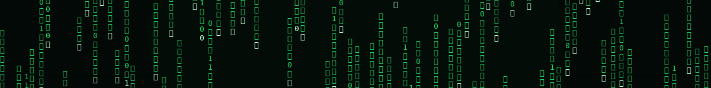

<div align="center">



</div>


```bash
$ whoami
> João — estudante de Ciência da Computação (2º período)

$ cat objetivo.txt
> Aprender construindo projetos, explorando Python,
> redes de computadores e cibersegurança.

$ status --now
> [ ONLINE ] Estudando e desenvolvendo projetos pessoais
```

## `~/tecnologias & ferramentas`

<div align="center">


</div>

---

## `~/atualmente-estudando`

<div align="center">

<table>
  <tr>
    <td><b>ÁREA</b></td>
    <td><b>FOCO DE ESTUDO</b></td>
  </tr>
  <tr>
    <td><code>01</code> <b>Python</b></td>
    <td>Automação · POO · Projetos</td>
  </tr>
  <tr>
    <td><code>02</code> <b>Redes</b></td>
    <td>TCP/IP · Sockets · Portas</td>
  </tr>
  <tr>
    <td><code>03</code> <b>Cibersegurança</b></td>
    <td>Reconhecimento · Pentest</td>
  </tr>
  <tr>
    <td><code>04</code> <b>Linux</b></td>
    <td>Terminal · Bash · Permissões</td>
  </tr>
</table>

</div>

---

## `~/projetos`

<div align="center">
  
</div>

## `~/objetivo`

Continuar desenvolvendo projetos, fortalecendo minha base em programação e adquirindo experiência prática na área de Tecnologia.

Tenho interesse em oportunidades que permitam aprender, colaborar e evoluir profissionalmente.

<div align="center">

<a href="https://www.linkedin.com/in/joaomarcelocd">
  
</a>
<a href="mailto:carvalho.joao.140206@gmail.com">
  
</a>

</div>

<div align="center">


</div>
