## `> whoami`

Estudante do **2º período de Ciência da Computação**. Desenvolvo em **Python** e estudo **redes** e **cibersegurança**, com interesse em entender o que acontece por baixo do capô: como os pacotes trafegam, quais portas ficam expostas e por que um sistema falha.

Cada projeto publicado aqui nasce dessa curiosidade, e serve para aprender construindo.


## `> ls ~/skills`

```text
~/skills
├── python        automação · POO · arquivos
├── redes         TCP/IP · sockets · portas e serviços
├── linux         terminal · Bash · administração básica
├── seguranca     scanning · reconhecimento · fundamentos
└── git           versionamento · portfólio
```


## `> ls ~/projetos`

<a href="https://github.com/jota1jpg/Port-Scanner-Basic-py">
  
</a>

Scanner TCP feito do zero com `sockets`, para identificar portas abertas e mapear serviços em rede.

<sub>⚠️ Ferramentas com finalidade educacional, para uso apenas em ambientes próprios ou autorizados.</sub>


## `> ping jota1jpg`

Em busca da primeira oportunidade de estágio em Tecnologia, em Infraestrutura, Redes ou Segurança da Informação.

<a href="https://www.linkedin.com/in/joaomarcelocd" target="_blank">
  
</a>
<a href="mailto:carvalho.joao.140206@gmail.com">
  
</a>


