<div align="center">




<p>
  <a href="https://www.linkedin.com/in/joaomarcelocd" target="_blank">
    
  </a>
  <a href="mailto:carvalho.joao.140206@gmail.com">
    
  </a>
  
</p>

</div>

---

## `> sobre_mim`

Sou estudante do **2º período de Ciência da Computação** e desenvolvo em **Python**. Meus estudos estão direcionados para **Cibersegurança** e **Redes de Computadores**.

Tenho interesse em compreender o funcionamento interno dos sistemas: o tráfego de pacotes, a exposição de portas e as causas de falhas de segurança. Os projetos publicados neste perfil partem desse interesse e têm como propósito consolidar o aprendizado por meio da prática.

```bash
$ cat objetivo.txt
Aplicar os conhecimentos acadêmicos em projetos práticos: automação com Python,
ferramentas de rede e soluções voltadas à cibersegurança.
```

---

## `> scan --competencias`

```text
$ nmap -sV joao.local

PORTA     ESTADO    SERVIÇO          DETALHES
22/tcp    aberta    python           automação, POO, manipulação de arquivos
80/tcp    aberta    redes            TCP/IP, sockets, portas e serviços
443/tcp   aberta    linux            terminal, Bash, administração básica
8080/tcp  aberta    git/github       versionamento de código e portfólio
1337/tcp  filtrada  ciberseguranca   scanning, reconhecimento, fundamentos (em desenvolvimento)

Varredura concluída: 5 serviços identificados
```

<div align="center">


</div>

---

## `> ls projetos/`

<div align="center">

<a href="https://github.com/jota1jpg/Port-Scanner-Basic-py">
  
</a>

</div>

> **🔎 Port-Scanner-Basic-py**: scanner TCP desenvolvido em Python para identificar portas abertas e mapear serviços em rede. Construído do zero com `sockets`, com o objetivo de compreender, na prática, o funcionamento do reconhecimento de hosts.
>
> `Python` · `Sockets` · `Threading` · `Redes`

<div align="center">

<sub>⚠️ Todas as ferramentas aqui apresentadas possuem finalidade educacional e devem ser utilizadas apenas em ambientes próprios ou devidamente autorizados.</sub>

</div>

---

## `> stats`

<div align="center">


</div>

---

## `> contato`

Busco minha **primeira oportunidade de estágio em Tecnologia**, preferencialmente nas áreas de Infraestrutura, Redes ou Segurança da Informação, onde possa aplicar o que venho desenvolvendo em Python, aprender com profissionais experientes e dar continuidade à minha formação.

```bash
$ ping joao
64 bytes from joao: disponível para conversar sobre Python, Linux e segurança da informação
```

<div align="center">

<a href="https://www.linkedin.com/in/joaomarcelocd" target="_blank">
  
</a>


</div>
